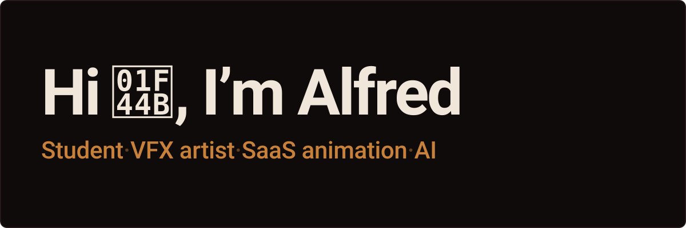
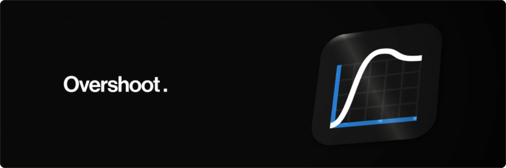
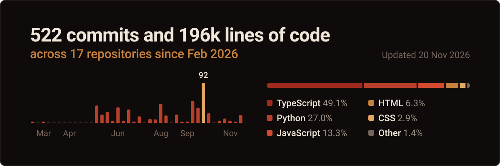

 

## Overshoot

I run Overshoot, creating high-end motion for software products. From product demos to launch films, I help ambitious teams turn great products into compelling visual experiences.

Everything is crafted by hand in After Effects, working directly with the product interface.

[Overshootfx.com](https://overshootfx.com)

## Stack

<b>Using</b> 

<b>Learning</b> 

## Selected projects

### Protocol

A personal training and performance system built around adaptive programming. Protocol combines training science, statistical modelling and personal data to create a system that continuously learns and evolves with its user.

How it's built

- Adaptive training engine with personalised strength, fatigue and recovery models.
- Statistical progression, volume management and nutrition adjustments.
- Predictive focus modelling and automated daily planning.
- Next.js 16, React 19, TypeScript, Dexie and Upstash Redis.
- Offline-first architecture with automated testing.

[Try Protocol](https://protocol-xi-six.vercel.app/)

### Syllune

Local dictation and private meeting notes for Windows. Hold a shortcut, speak, and Syllune types what you said wherever your cursor is. Speech recognition runs entirely on your own computer, so nothing is uploaded, there is no account, and it works offline.

How it's built

- Python speech engine built on faster-whisper, using an NVIDIA GPU when available and the CPU otherwise.
- Electron overlay: a floating pill that rests at the screen edge and opens when your cursor comes near.
- Personal vocabulary that learns names and terms, plus meeting recording, voice notes and searchable history.
- Optional cleanup of longer dictations with a local model through Ollama.
- English and Swedish, automated testing and a per-user Windows installer.

[Download Syllune](https://github.com/Loathious/Syllune/releases)

### Archvfinds

A fashion discovery platform bringing together archive labels, independent brands and cross-border shopping. One catalog, multiple buying agents, and a unified link system that makes the entire experience seamless.

How it's built

- Static Next.js architecture with automated catalog generation.
- Universal buying-agent link conversion.
- Custom discovery and popularity algorithms.
- First-party analytics and a custom Discord bot.

[Archvfinds.com](https://archvfinds.com)

### Local LLMs

Exploring local AI infrastructure through Ollama and custom API gateways. Building a foundation for integrating open-weight models directly into applications and personal tools, without depending on hosted inference.

### Microcontrollers and hardware hacking

Experimenting with embedded systems, custom firmware and hardware modification. Mostly ESP32-based projects, from custom display integrations to reverse engineering communication protocols and repurposing existing devices.
